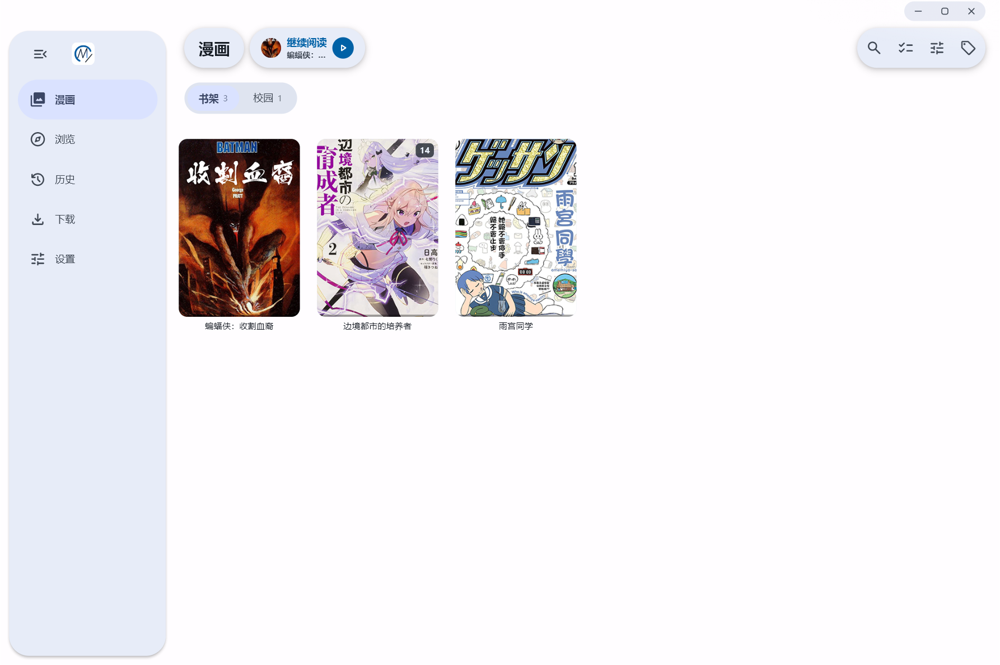
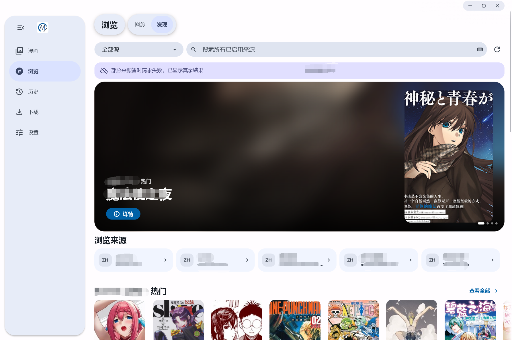
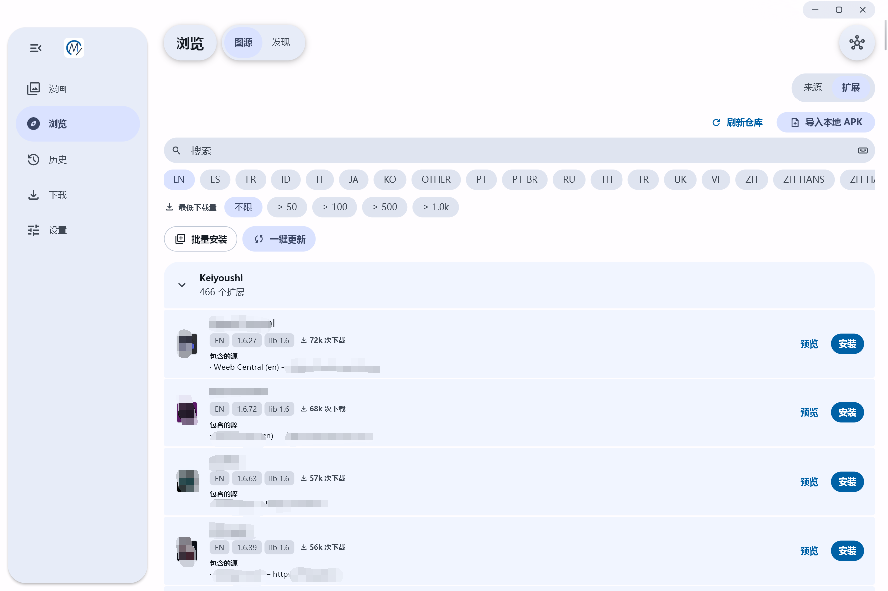
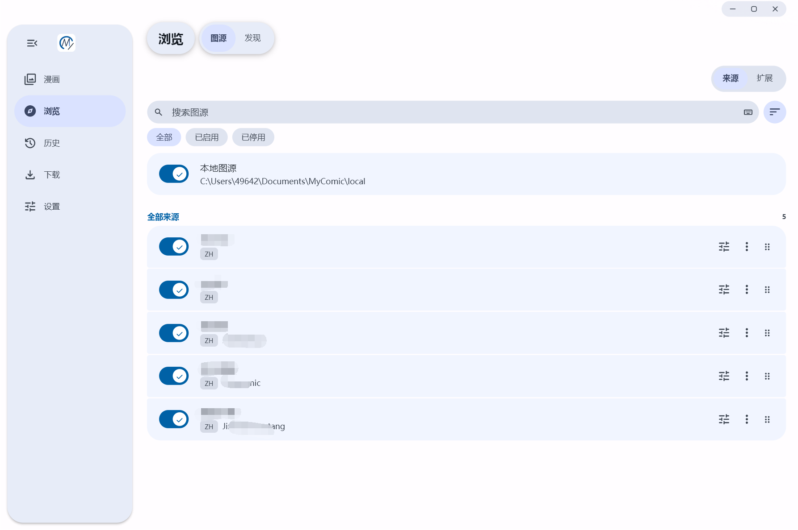
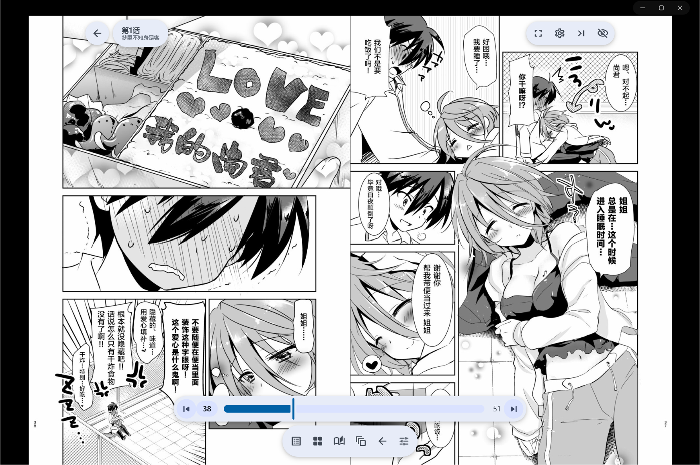

<div align="center">


**A Mihon-compatible manga reader for Windows.**

**English** | [简体中文](README.md)


</div>

## Background

MyComic was born because I read manga with Mihon, and my downloaded manga filled up my phone's storage. I didn't want to delete those downloads, so I wondered whether I could install a PC version of Mihon, restore my backup there, and store the manga on my computer.

But I found that GitHub had no Mihon desktop client that looked good and was easy to use. The closest was Fushi, an open-source project that perfectly supports Mihon's extension repositories and features, but cannot read Mihon backup files.

After a lot of thinking and learning, I decided to use AI to build a PC desktop manga reader that fully supports Mihon extensions and backups.

MyComic is an independent Windows desktop manga reader based on the frozen Fushi v3.0.0 snapshot (GPL-3.0); it is not affiliated with or endorsed by the Fushi or Mihon projects.

## Screenshots

<p align="center"></p>

<p align="center"></p>

<p align="center"></p>

<p align="center"></p>

<p align="center"></p>

This application does not bundle any extensions or extension repositories. If you need them, search for [keiyoushi/extensions](https://github.com/keiyoushi/extensions) on GitHub.

**Importing local manga:**

1. Go to Settings - Storage & downloads - Storage location - Open folder.
2. Put your local manga in the `<local>` folder. The layout is `local / manga title / chapter.cbz` (or a chapter folder).
3. Then go to Browse - Local source and select your manga to import it.

## Features

- **Library** — keep manga on your shelf, organize them with tags, search and filter, and continue where you left off.
- **Manga pages and global search** — browse details, chapter lists and source genres, and search every enabled online source from one place.
- **Reader** — spread, vertical-page and webtoon reading modes with per-series preferences, reading progress and history.
- **Online sources** — browse, search and read through Mihon extensions installed from extension stores.
- **Downloads** — download chapters for offline reading, saved as CBZ archives by default (plain folders are also supported), with pause, resume, retry and cancel controls.
- **Local source** — read manga folders and CBZ files in place from your Content root without importing or copying them.
- **History** — one entry per series with the last-read chapter and cover.
- **Backup** — import and export Mihon-compatible `.tachibk` backups.
- **Four interface languages** — English, 简体中文, 繁體中文, 日本語; the interface follows the system language and falls back to English.
- **Onboarding** — a three-step guide for language, theme and Content root, reopenable from Settings.

## Mihon compatibility

MyComic is a **Mihon-compatible desktop reader**, not an official Mihon product or a port of the Mihon app:

- It runs **Mihon extensions** through a bundled extension runtime, so you do not need to install Java or run a separate server.
- It imports and exports **Mihon v0.21.3 `.tachibk` backups**; backup categories map to MyComic tags.
- Extension behavior is compatible with the frozen Fushi v3.0.0 baseline.

## Install on Windows

1. Download the latest `mycomic-<version>-windows-setup.exe` from [GitHub Releases](https://github.com/Myyuluo/my-comic/releases).
2. Run the installer. It installs to `C:\Program Files\MyComic` (64-bit) and requires administrator rights (UAC).
3. Start **MyComic** from the Start menu or the desktop shortcut.

Requirements: **Windows 10 or Windows 11 (64-bit)**.

> Upgrading from an older Fushi-based build: MyComic is a clean break. Uninstall the old application manually before installing MyComic; user data in the Program state root is not migrated. Old `fushi://` deep links and `fushi-` update assets are no longer compatible, so update or reinstall manually once. Downloads, local manga and backups under your Content root (`Documents\MyComic` by default) stay where they are. If you installed an earlier per-user MyComic build, back up `%LOCALAPPDATA%\MyComic\userdata` before uninstalling it; the old uninstaller removes that directory.

## Build from source

Prerequisites: Windows 10/11 (64-bit), [Flutter](https://docs.flutter.dev/get-started/install/windows) **3.47.6**, Visual Studio 2022 with the **Desktop development with C++** workload, and Git Bash (used by the dependency patch script). Inno Setup 6 is only needed to compile the installer locally; CI builds the release installer.

```powershell
# From the repository root: flutter pub get + apply third-party patches
.\tool\bootstrap.ps1

# Run the app
cd my_comic
flutter run -d windows

# Build a release executable
flutter build windows --release
# Output: my_comic\build\windows\x64\runner\Release\MyComic.exe
```

Quality gates used by CI:

```powershell
cd my_comic
dart run slang                 # regenerate localization code
flutter analyze --no-pub
flutter test --no-pub
```

The Melos workspace packages live in `packages/my_comic_*`; vendored patched dependencies live in `third_party/` and are applied by the bootstrap script. The Windows installer definition is `my_comic/windows/installer/mycomic.iss`.

## Data and privacy

- **Content root** — `Documents\MyComic` by default, containing `downloads`, `autobackup` and `local`. It is not removed when you uninstall the app.
- **Program state** — the database, settings, extensions and caches live next to the installed application. If the install directory is not writable by the current user (for example `C:\Program Files`), MyComic falls back to `%LOCALAPPDATA%\MyComic\userdata`; uninstalling removes them.
- **No telemetry** — MyComic does not send usage statistics, and it has no accounts, cloud sync, feedback center or leaderboard. Network access happens only when you use online sources or extensions, and update checks query this repository's GitHub Releases.

## Project layout

```
my_comic/           Flutter application (Dart package `my_comic`)
packages/           Workspace packages (`my_comic_core`, `my_comic_engine`, ...)
native/             Native components and Windows integration
third_party/        Vendored/patch source for dependencies
ci/                 Dependency patches and CI helpers
tool/               Bootstrap, audit and developer scripts
docs/adr/           Architecture decision records
```

Start with [CLAUDE.md](CLAUDE.md) for repository rules, [GLOSSARY.md](GLOSSARY.md) for domain terms, and [`docs/adr/0024-windows-only-independent-identity.md`](docs/adr/0024-windows-only-independent-identity.md) for the Windows-only, independent-identity decision. Upstream provenance is recorded in [UPSTREAM.md](UPSTREAM.md).

## License

MyComic is distributed under the **GNU General Public License v3.0**; see [LICENSE](LICENSE) for the full text. Third-party licenses and notices are kept in `third_party/` (including `LICENSE`, `NOTICE` and `PATCHES.md`) and in [`my_comic/docs/licenses/`](my_comic/docs/licenses/).

Copyright © 2026 Fushi contributors. Copyright © 2026 MyComic contributors.
